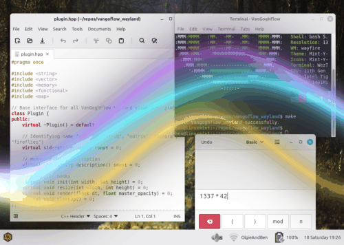

<p align="center">
  
</p>

<h1 align="center">Van Gogh Flow for Wayland</h1>

<p align="center">
  <b>A lightweight, GPU-accelerated, 100% click-through desktop overlay visualizer for Wayland compositors.</b>
</p>

<p align="center">
  <a href="https://github.com/denvercoder1/readme-typing-svg">
    
  </a>
</p>

<p align="center">
  
  
  
  
  
</p>

---

## 🌌 Overview

**Van Gogh Flow for Wayland** (`vangoghflow_wayland`) is an ambient desktop overlay HUD designed for modern Wayland compositors (such as [Wayfire](https://wayfire.org/), [Sway](https://swaywm.org/), [Hyprland](https://hyprland.org/), and [Labwc](https://github.com/labwc/labwc)). 

It renders hypnotic, flow-state inducing procedural visualizations across your entire desktop on the Wayland `OVERLAY` layer while remaining **100% transparent and click-through**. Pointer clicks, scrolling, gestures, and keystrokes pass directly to your code editors, terminals, and browser windows without a microsecond of interception.

<p align="center">
  
  <br />
  <em>Real-time capture of Van Gogh Flow running over a desktop (cycling through Aurora, Starfield, Matrix, and Fireflies plugins)</em>
</p>

---

## 🖥️ What is a Compositor? (And Why Wayland Changes Everything)

To understand how Van Gogh Flow works under the hood, it helps to understand how graphical user interfaces have fundamentally changed over the past two decades.

### The Old Era: Shared Framebuffers & Redraw Messages (Win32 & Classic X11)
In classical windowing systems—such as legacy **Win32** (Windows 95 through XP) and non-composited **X11**:
- Windows painted their pixels directly into a **shared screen buffer**.
- When you moved, resized, or dragged a window over another, the OS calculated "dirty regions" and bombarded every obscured window with redraw messages (like Win32's `WM_PAINT` and `InvalidateRect`).
- Each application was responsible for repainting its exposed rectangles on demand.
- If a program hung, was slow, or missed a redraw message, you saw the infamous **"Windows Solitaire trail"**—frozen window ghosting smeared across your display.
- True, full-desktop transparency across multiple overlapping apps was virtually impossible without complex, flickering, CPU-heavy clipping hacks.

```
  Traditional Windowing (Win32 WM_PAINT / Classic X11)
  ┌────────────────────────────────────────────────────────┐
  │                   Shared Screen Buffer                 │
  │   ┌─────────────┐                                      │
  │   │ App Window  │ ──► InvalidateRect / WM_PAINT        │
  │   │   (Ghosting!│     Each app draws directly to glass │
  │   └──────┬──────┘                                      │
  └──────────┼─────────────────────────────────────────────┘
             ▼ (Lagging apps cause tearing & smearing)
```

### The Modern Era: Compositors as 3D Scene Directors
Modern desktop environments—like **Wayland** and Windows with DWM (Desktop Window Manager)—completely inverted this model:
- **Every application renders into its own private, off-screen GPU memory buffer (a texture).** No window ever touches another window's pixels.
- The **Compositor** (e.g., Wayfire, Sway, Hyprland, Labwc) acts like a real-time 3D game engine or video compositing suite.
- Every frame (at 60Hz, 144Hz, or faster), the compositor takes all those individual off-screen textures, arranges them in 3D layers, blends them using the GPU's hardware alpha channels, and presents the combined frame to the display.
- **Every frame is perfectly synchronized (VSync)**: Zero tearing, zero redraw storms, and zero ghosting.

```
  Modern Compositing (Wayland Compositors & DWM)
  ┌───────────────┐     ┌───────────────┐     ┌────────────────────────┐
  │  Code Editor  │     │  Web Browser  │     │   Van Gogh Flow HUD    │
  │  (GPU Buffer) │     │  (GPU Buffer) │     │   (Translucent Buffer) │
  └───────┬───────┘     └───────┬───────┘     └───────────┬────────────┘
          │                     │                         │
          └─────────────────────┼─────────────────────────┘
                                ▼
                   ┌────────────────────────┐
                   │   WAYLAND COMPOSITOR   │ (GPU Blending & Alpha Shaders)
                   └────────────┬───────────┘
                                ▼
                       Monitor (Teardrop-Free)
```

Because Wayland compositors natively blend surfaces on the GPU, **Van Gogh Flow for Wayland** can float full-screen visualizers across your workspace with absolute transparency, native refresh rates, and zero disruption to the applications underneath.

---

## 🎨 The Three Iterations of Van Gogh Flow

The concept of an ambient, flow-inducing transparent desktop visualizer has evolved across three distinct generations, each engineered by **Benjamin Pritchard** to tackle the technical paradigms of its era.

```
       1st Iteration (2019)                   2nd Iteration (2021)                   3rd Iteration (2026)
  ┌─────────────────────────────┐        ┌─────────────────────────────┐        ┌─────────────────────────────┐
  │         VanGoghFlow         │        │       VanGoghFlowGTK3       │        │     vangoflow_wayland       │
  │     (Win32 / C# / CEF)      │  ───>  │   (Linux X11 / C / GTK3)    │  ───>  │  (Wayland / C++17 / GLES2)  │
  │                             │        │                             │        │                             │
  │ • Windows 10 DWM            │        │ • Linux X11 compositors     │        │ • Direct Wayland client     │
  │ • WS_EX_TRANSPARENT         │        │ • GTK3 + WebKit2GTK         │        │ • zwlr_layer_shell_v1       │
  │ • CefSharp (Embedded CEF)   │        │ • C11 + libappindicator3    │        │ • Native EGL & GLES2 GLSL   │
  │ • YouTube video streams     │        │ • YouTube video streams     │        │ • Procedural GPU shaders    │
  └─────────────────────────────┘        └─────────────────────────────┘        └─────────────────────────────┘
```

### 1. Iteration 1: [VanGoghFlow (Win32)](https://github.com/benjaminPritchard/vanGoghFlow/)
* **Platform**: Windows 10 (Win32)
* **Language & Framework**: C#, .NET Framework, Visual Studio
* **Author**: Hand-written by **Benjamin Pritchard** (Kundalini Software)
* **Architecture**:
  * Utilized the Windows Desktop Window Manager (DWM) compositing engine by configuring extended Win32 window styles (`WS_EX_LAYERED | WS_EX_TRANSPARENT`) to achieve a full-screen, click-through transparent canvas.
  * Embedded the `CefSharp` wrapper around the Chromium Embedded Framework (CEF) to load and render curated YouTube ambient videos and fractal animations directly across the workspace.
  * Handled configuration through a local `VanGoghFlow.INI` file, allowing users to map arbitrary YouTube video IDs to customizable desktop backdrops.
  * Pioneered the core hypothesis: subtle, continuous visual motion in the peripheral visual field gently induces and maintains deep creative flow states.

### 2. Iteration 2: [VanGoghFlowGTK3 (Linux X11)](https://github.com/BenjaminPritchard/VanGoghFlowGTK3)
* **Platform**: Linux (X11 with compositing window managers such as Muffin / Compiz / Mutter)
* **Language & Framework**: Pure C (C11), GTK+ 3.0, WebKit2GTK
* **Author**: Written by **Benjamin Pritchard**
* **Architecture**:
  * Re-architected the system for Linux environments. Eliminated the .NET runtime in favor of clean, performant C compiled with Clang.
  * Paired `GTK+ 3.0` with `WebKit2GTK` (`webkit2gtk-4.0`) to display transparent web-based visuals on top of X11 compositors.
  * Added global hotkeys via X11 / XInput (`F3` / `F4` as "volume keys" to dynamically dial opacity up or down) and integrated a system tray applet using `libappindicator3`.
  * Identified the opportunity to eventually move away from heavyweight web engines and pre-rendered video streams toward real-time GPU procedural generation.

### 3. Iteration 3: Van Gogh Flow for Wayland (This Repository)
* **Platform**: Linux Wayland (wlroots compositors: Wayfire, Sway, Hyprland, Labwc)
* **Language & Architecture**: Modern C++ (C++17), Wayland Client, EGL, OpenGL ES 2.0
* **Author**: Engineered by **Benjamin Pritchard**
* **Architecture Breakthroughs**:
  * **No Web Engine, Pure GPU Shaders**: Completely discarded heavy browser engines (Chromium / WebKit) and video network streams. All visualizers are written in native GLSL shaders, running at native monitor refresh rates with virtually zero CPU usage and microscopic memory footprint.
  * **`zwlr_layer_shell_v1` Protocol**: Connects directly to the compositor on `ZWLR_LAYER_SHELL_V1_LAYER_OVERLAY`. The visuals overlay all windows (floating, tiled, fullscreen) and desktop panels.
  * **The 100% Click-Through Guarantee**: High-level toolkits like GTK silently reset the `wl_surface` input region during window layout mapping passes, inadvertently trapping mouse clicks and blocking interactions with applications underneath. By avoiding UI toolkits and interfacing directly with `wayland-client`, Van Gogh Flow commits an empty `wl_region` (`wl_surface_set_input_region(surface, empty_region)`), guaranteeing permanent, unfailing 100% click-through.
  * **Modular C++ Plugin Architecture**: Features an extensible plugin registry (`plugin.hpp`) with self-registering factory macros (`REGISTER_PLUGIN`). Adding new visualizers requires only implementing `init()`, `resize()`, and `render()`.
  * **Direct EGL & Native GLES2**: Binds EGL with 8-bit alpha channels (`EGL_ALPHA_SIZE, 8`) directly over `wl_egl_window`, eliminating Desktop OpenGL Core profile issues with point size and `#version 100` compatibility.

---

## 🏛️ Architecture of Van Gogh Flow for Wayland

The software is designed as a direct, high-performance Wayland EGL client without intermediary windowing toolkits:

```
  ┌────────────────────────────────────────────────────────────────────────┐
  │                 Van Gogh Flow Wayland (Single Binary)                  │
  │                                                                        │
  │   ┌────────────────────────────────────────────────────────────────┐   │
  │   │                       Driver Program                           │   │
  │   │                (vangoghflow_wayland.cpp)                       │   │
  │   │                                                                │   │
  │   │  • wl_display & wl_registry connection                         │   │
  │   │  • zwlr_layer_shell_v1 (Layer: OVERLAY, Anchors: Top/Bot/L/R) │   │
  │   │  • Empty wl_region (100% Click-Through Guarantee)              │   │
  │   │  • EGLDisplay / EGLContext (EGL_ALPHA_SIZE: 8, GLES2)          │   │
  │   │  • VSync Frame Pacing (wl_surface_frame callback loop)         │   │
  │   └───────────────────────────────┬────────────────────────────────┘   │
  │                                   │                                    │
  │                                   ▼                                    │
  │   ┌────────────────────────────────────────────────────────────────┐   │
  │   │                   Modular Plugin Engine                        │   │
  │   │                       (plugin.hpp)                             │   │
  │   │                                                                │   │
  │   │  [aurora]         [starfield]        [matrix]      [fireflies] │   │
  │   │  GLSL Plasma      GLSL 3D Warp       GLSL Rain     GLSL Orbs   │   │
  │   └────────────────────────────────────────────────────────────────┘   │
  └───────────────────────────────────┬────────────────────────────────────┘
                                      │
                                      ▼
                      Wayland Compositor (EGL / wlroots)
```

1. **Protocol Negotiation (`zwlr_layer_shell_v1`)**:
   - Creates a layer surface anchored to all four edges (`TOP | BOTTOM | LEFT | RIGHT`) matching the exact monitor dimensions.
   - Binds to `ZWLR_LAYER_SHELL_V1_LAYER_OVERLAY`—the highest visual plane in Wayland, sitting above application windows, notification bubbles, and status bars.
   - Sets keyboard interactivity to `NONE` so keypresses are never absorbed.

2. **The 100% Click-Through Guarantee**:
   - Configures an empty `wl_region` via `wl_surface_set_input_region(surface, empty_region)`.
   - In UI toolkits (like GTK or Qt), the toolkit's internal layout engines repeatedly recalculate and overwrite the input mask, causing mouse clicks to get intercepted by the invisible overlay.
   - By speaking directly to `wayland-client`, Van Gogh Flow retains exclusive control over the surface, ensuring the input region remains permanently empty. Every mouse click and scroll event falls through to the windows below.

3. **Direct EGL & Native OpenGL ES 2.0**:
   - Obtains an EGL display directly from `wl_display` and creates an EGL window surface over `wl_egl_window`.
   - Explicitly configures an 8-bit alpha channel (`EGL_ALPHA_SIZE, 8`) so that unpainted areas (`glClearColor(0,0,0,0)`) remain completely transparent.
   - Uses native OpenGL ES 2.0 rather than Desktop OpenGL Core profile, guaranteeing seamless support for `#version 100` GLSL shaders and point sprites without profile incompatibilities.

4. **VSync-Locked Frame Pacing**:
   - Eliminates timer polling or CPU spin loops.
   - Requests a `wl_surface_frame` callback on each swap, allowing the compositor to schedule the next frame at the monitor's exact refresh rate (60Hz, 120Hz, 144Hz, 240Hz).

---

## 🌠 Visualizer Gallery

All plugins are compiled directly into the binary and can be switched instantaneously from the command line:

| Plugin | Preview | Description |
| :--- | :---: | :--- |
| **`aurora`** |  | Flowing cosmic plasma ribbons and psychedelic waves inspired by Vincent van Gogh's *The Starry Night*. |
| **`starfield`** *(default)* |  | 3D warp-speed starfield with multi-colored twinkling point sprites accelerating toward the viewer. |
| **`matrix`** |  | Cyberpunk digital rain cascades with glowing phosphor-green code trails and bright leading glyphs. |
| **`fireflies`** |  | Luminous floating neon fireflies and drifting bioluminescent particles with soft radial halos. |

---

## 🛠️ Building & Prerequisites

### System Requirements
You will need a Wayland compositor that supports the `wlr-layer-shell-unstable-v1` protocol:
- [Wayfire](https://wayfire.org/)
- [Labwc](https://github.com/labwc/labwc)
- [Sway](https://swaywm.org/)
- [Hyprland](https://hyprland.org/)

### Dependencies
On Ubuntu / Debian / Linux Mint:
```bash
sudo apt-get install \
  build-essential \
  pkg-config \
  wayland-protocols \
  libwayland-dev \
  libwayland-egl1 \
  libegl1-mesa-dev \
  libgles2-mesa-dev
```

### Compiling
Clone the repository and run `make`:
```bash
git clone https://github.com/BenjaminPritchard/vangoflow_wayland.git
cd vangoflow_wayland
make
```

This compiles the Wayland protocol boilerplate, the driver executable, and all built-in plugins into a single, dependency-light binary: `./vangoghflow_wayland`.

---

## 🚀 Usage

### 1. List Available Plugins
```bash
./vangoghflow_wayland --list
```
Output:
```text
=========================================
 VanGoghFlow Wayland Compiled-in Plugins
=========================================

  * aurora       - Flowing cosmic aurora and psychedelic energy ribbons inspired by Van Gogh's Starry Night
  * fireflies    - Luminous floating neon fireflies and gentle drifting orbs
  * matrix       - Cyberpunk digital rain with cascading glowing code glyphs
  * starfield    - Vibrant 3D warp starfield with large, glowing colorful stars

Default: 'starfield'
```

### 2. Run Default Starfield
```bash
./vangoghflow_wayland
```

### 3. Run a Specific Plugin
```bash
./vangoghflow_wayland aurora
./vangoghflow_wayland matrix
./vangoghflow_wayland fireflies
```

### 4. Custom Opacity
Dial down intensity for high-focus coding or dial it up for immersive flow:
```bash
# Set master opacity multiplier (0.0 to 1.0)
./vangoghflow_wayland aurora -o 0.75
```

### 5. Running Nested (Development & Testing)
If you are developing or testing plugins inside an existing X11 or Wayland session without affecting your primary desktop, use the included nested launcher:
```bash
./launch_nested.sh aurora
```
This automatically spins up a nested Wayfire or Labwc session, locates the assigned Wayland socket, and runs the visualizer within that sandbox.

---

## 🧩 How to Develop Your Own Plugins

Van Gogh Flow uses a modular C++ plugin architecture ([plugin.hpp](plugin.hpp)) with self-registering factory macros. Creating and compiling a new visualizer requires zero changes to the driver or Makefile!

### Step 1: Plugin Anatomy
Every visualizer inherits from the abstract base class `Plugin`:

```cpp
class Plugin {
public:
    virtual ~Plugin() = default;

    // CLI identifier and descriptive summary
    virtual std::string name() const = 0;
    virtual std::string description() const = 0;

    // Lifecycle methods
    virtual bool init(int width, int height) = 0;
    virtual void resize(int width, int height) = 0;
    virtual void render(float dt, float master_opacity) = 0;
};
```

- **`name()`**: The unique CLI name (e.g. `rings`, `kaleidoscope`). Used by `--plugin <name>` and `--list`.
- **`description()`**: Human-readable explanation shown in `./vangoghflow_wayland --list`.
- **`init(int width, int height)`**: Called once when the layer surface is configured. Compile your GLSL vertex and fragment shaders, query uniform locations, and allocate vertex buffers here.
- **`resize(int width, int height)`**: Called whenever display resolution or output changes. Update `glViewport(0, 0, width, height)` and any resolution uniforms (`u_resolution`).
- **`render(float dt, float master_opacity)`**: Called every VSync tick:
  - `dt`: Delta time in seconds since the previous frame.
  - `master_opacity`: Master intensity multiplier (0.0 to 1.0) passed from the `--opacity` flag.
  - Always start your render pass by clearing with transparent black: `glClearColor(0.0f, 0.0f, 0.0f, 0.0f); glClear(GL_COLOR_BUFFER_BIT);`
  - Draw your procedural effect with alpha blending (`glEnable(GL_BLEND); glBlendFunc(GL_SRC_ALPHA, GL_ONE_MINUS_SRC_ALPHA);`).

### Step 2: Create Your Plugin File
Create a new directory and source file under `plugins/`:
```bash
mkdir -p plugins/my_visualizer
```
Create `plugins/my_visualizer/my_visualizer.cpp`:

```cpp
#include "plugin.hpp"
#include <GLES2/gl2.h>
#include <iostream>

class MyVisualizerPlugin : public Plugin {
public:
    std::string name() const override { 
        return "my_visualizer"; 
    }
    
    std::string description() const override { 
        return "Hypnotic expanding glowing geometric rings"; 
    }

    bool init(int width, int height) override {
        // Compile your GLES2 shaders and setup geometries here
        resize(width, height);
        return true;
    }

    void resize(int width, int height) override {
        m_width = width;
        m_height = height;
        glViewport(0, 0, width, height);
    }

    void render(float dt, float master_opacity) override {
        m_time += dt;

        // 1. Maintain full background transparency
        glClearColor(0.0f, 0.0f, 0.0f, 0.0f);
        glClear(GL_COLOR_BUFFER_BIT);

        // 2. Enable alpha blending for translucent glow
        glEnable(GL_BLEND);
        glBlendFunc(GL_SRC_ALPHA, GL_ONE_MINUS_SRC_ALPHA);

        // 3. Render your shader pass using dt, m_time, and master_opacity...
    }

private:
    int m_width = 0;
    int m_height = 0;
    float m_time = 0.0f;
};

// Auto-register into the global registry at static initialization
REGISTER_PLUGIN(MyVisualizerPlugin);
```

### Step 3: Build & Test
The `Makefile` automatically discovers all `.cpp` files matching `plugins/*/*.cpp`:
```bash
make
```

Verify your new plugin appears in the list:
```bash
./vangoghflow_wayland --list
```

Run it immediately:
```bash
./vangoghflow_wayland my_visualizer
```

Or test it safely inside a nested compositor sandbox:
```bash
./launch_nested.sh my_visualizer
```

---

## 📜 Credits & License

- **Original Author & Architect**: **Benjamin Pritchard** ([Kundalini Software](https://www.kundalinisoftware.com/van-gogh-flow/))
- **Animated Typing SVG**: DenverCoder1's [readme-typing-svg](https://github.com/denvercoder1/readme-typing-svg)
- **License**: MIT License. See [LICENSE](LICENSE) for details.
